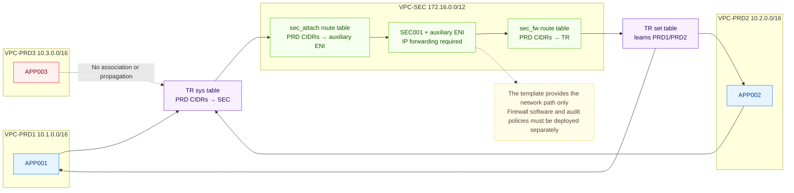

# Enterprise Cloud Network Architecture

English | [简体中文](README.zh-CN.md)

Plan and deploy a network architecture centered on a transit router. Cross-VPC east-west traffic is forced through a security VPC for centralized inspection and auditing, preventing direct business bypass paths and limiting lateral threat movement. Independent workloads are isolated by default and can be connected when required. The architecture supports MLPS compliance requirements and is delivered through Terraform for repeatable, auditable deployment and cleanup.

## 1. Business Background

When migrating from an IDC to the cloud or improving an existing cloud network, enterprises commonly need to address the following requirements:

- **Controlled connectivity and isolation must coexist**: some business zones must communicate, while others must remain independent.
- **East-west traffic lacks a centralized control point**: cross-zone traffic must pass through a security zone so that firewall and audit policies can be added later.
- **Direct routes can bypass the security zone**: if business VPCs have a direct forwarding path, the security zone is no longer mandatory.
- **Environments must be delivered and reclaimed consistently**: networks, instances, and routing relationships must be created, changed, and destroyed through declarative configuration.

This template uses Terraform to deploy VPCs, subnets, security groups, a transit router (TR), ECS instances, an auxiliary ENI, and routing relationships, providing a network foundation for controlled cross-VPC communication.

## 2. Solution Overview

The template uses a "4 VPCs + 1 TR + 1 SEC forwarding instance" architecture:

- **VPC-PRD1 / VPC-PRD2**: host APP001 and APP002 respectively. Both VPCs are associated with the TR `sys` route table, which sends traffic destined for PRD1 or PRD2 to VPC-SEC first.
- **VPC-SEC**: hosts SEC001 and its auxiliary ENI. The attachment-subnet route table sends traffic to the auxiliary ENI, while the firewall-subnet route table returns forwarded traffic to the TR.
- **TR `set` route table**: is associated with the SEC attachment and learns PRD1/PRD2 subnet routes, allowing traffic returned from SEC to reach the destination business zone.
- **VPC-PRD3**: has a TR attachment, but it is not associated with or propagated to a custom TR route table, and route synchronization is disabled. The current configuration therefore provides no path between PRD3 and the other VPCs.



For example, traffic from APP001 to APP002 follows this path:

```text
APP001
  → PRD1 VPC route
  → TR sys table
  → SEC attachment-subnet route
  → SEC001 auxiliary ENI
  → SEC001 kernel forwarding
  → SEC firewall-subnet route
  → TR set table
  → PRD2
  → APP002
```

Important boundaries:

- The template creates SEC001, an auxiliary ENI, and the traffic-steering path, but does not install a commercial firewall or auditing software.
- IPv4 forwarding must be enabled in the SEC001 operating system; otherwise, PRD1 and PRD2 cannot communicate through this node.
- The current architecture has one SEC001 instance, and all four ECS instances are deployed in `zone1`. Dual-zone TR attachment points do not provide firewall or application-instance high availability.
- The template does not create an EIP, NAT gateway, VPN, bastion host, or public load balancer.
- The current default value of `ssh_ingress_cidr` is `0.0.0.0/0`, which creates a TCP/22 ingress rule open to any IPv4 source in all four security groups. It must be restricted to a controlled management CIDR before production use.
- All four security groups also share two private-network, all-protocol ingress rules for `10.0.0.0/8` and `172.16.0.0/12`. Even after `ssh_ingress_cidr` is restricted, these private ranges still include TCP/22 and should be narrowed to the actual required protocols.

## 3. IaC Design

### 3.1 Resource Inventory

With the current code and example parameters, a complete deployment creates 44 Terraform-managed objects: 38 cloud resources and 6 `time_sleep` objects used only to sequence destruction.

| Terraform Resource | Purpose |
| --- | --- |
| `volcenginecc_vpc_vpc` ×4 | VPCs for PRD1, PRD2, PRD3, and SEC |
| `volcenginecc_vpc_subnet` ×9 | Two subnets for each PRD VPC, plus attachment, firewall, and secondary-zone subnets in SEC |
| `volcenginecc_vpc_security_group` ×4 | One security group per VPC, including inline ingress rules |
| `volcenginecc_ecs_instance` ×4 | APP001, APP002, APP003, and SEC001 |
| `volcenginecc_vpc_eni` ×1 | SEC001 auxiliary ENI with source/destination checking disabled |
| `volcenginecc_vpc_route_table` ×2 | SEC attachment-ingress route table and firewall-subnet return route table |
| `volcenginecc_transitrouter_transit_router` ×1 | Transit router connecting the four VPCs |
| `volcenginecc_transitrouter_vpc_attachment` ×4 | One TR attachment for each VPC |
| `volcenginecc_transitrouter_transit_router_route_table` ×2 | `sys` traffic-steering table and `set` return table |
| `volcenginecc_transitrouter_transit_router_route_table_association` ×3 | PRD1/PRD2 associated with `sys`, and SEC associated with `set` |
| `volcenginecc_transitrouter_route_table_propagation` ×2 | Route propagation from PRD1/PRD2 to `set` |
| `volcenginecc_transitrouter_transit_router_route_entry` ×2 | PRD1/PRD2 static routes in `sys` that point to SEC |
| `time_sleep` ×6 | Waits for cloud-side relationships to converge during destruction; does not create cloud resources |

The template contains no data sources and does not reference caller-supplied VPCs, subnets, TRs, or ECS instances. ECS system volumes are created inline with the instance resources and configured for deletion with the instances, so they are not counted as explicit standalone resources.

### 3.2 Project Structure

```text
terraform-volcenginecc-enterprise-cloud-network-architecture/
├── README.md
├── main.tf
├── variables.tf
├── outputs.tf
├── providers.tf
├── versions.tf
├── terraform.tfvars
└── modules/
    ├── network/
    │   ├── vpc.tf
    │   ├── transit_router.tf
    │   ├── routing.tf
    │   ├── variables.tf
    │   ├── outputs.tf
    │   └── versions.tf
    └── compute/
        ├── main.tf
        ├── variables.tf
        ├── outputs.tf
        └── versions.tf
```

Module responsibilities:

- The root module accepts user input, calls the `network` module, and passes subnet, security-group, TR, and CIDR outputs to the `compute` module.
- The `network` module creates VPCs, subnets, security groups, TR attachments, and TR routing relationships.
- The `compute` module creates ECS instances, the auxiliary ENI, and two VPC route tables in SEC.
- The `time_sleep` resources in the root and `network` modules only constrain destruction order; they do not participate in business traffic forwarding.

The child modules also define the following internal outputs for inter-module data flow. Unless the root module declares them again, they are not exposed through the final `terraform output`:

| Child Module | Internal Output | Purpose |
| --- | --- | --- |
| `network` | `subnet_ids` | Passes business and SEC subnet IDs to `compute` |
| `network` | `security_group_ids` | Passes the four security-group IDs to `compute` |
| `network` | `sec_vpc_id` | Selects the VPC that owns the SEC route tables |
| `network` | `sec_fw_subnet_id` | Selects the subnet that hosts SEC001 and the auxiliary ENI |
| `network` | `sec_attach_subnet_id` | Selects the subnet associated with the SEC attachment route table |
| `network` | `sec_transit_router_attachment_id` | Exposes the SEC attachment ID; the root module does not currently reuse or output it |
| `network` | `prd_cidr_blocks` | Passes the PRD1/PRD2 CIDRs to the SEC route tables |
| `compute` | `firewall_eni_id` | Exposes the auxiliary ENI ID; the root module does not currently output it |

### 3.3 Key Code Examples

The root module passes network resources to the compute module through module outputs:

```hcl
module "network" {
  source = "./modules/network"

  common_name      = var.common_name
  region           = var.region
  zone1            = var.zone1
  zone2            = var.zone2
  ssh_ingress_cidr = var.ssh_ingress_cidr
  tags             = var.tags
}

module "compute" {
  source = "./modules/compute"

  subnet_ids           = module.network.subnet_ids
  security_group_ids   = module.network.security_group_ids
  sec_vpc_id           = module.network.sec_vpc_id
  sec_fw_subnet_id     = module.network.sec_fw_subnet_id
  sec_attach_subnet_id = module.network.sec_attach_subnet_id
  transit_router_id    = module.network.transit_router_id
  prd_cidr_blocks      = module.network.prd_cidr_blocks
}
```

Static routes in the TR `sys` route table send business CIDR traffic to the SEC attachment:

```hcl
resource "volcenginecc_transitrouter_transit_router_route_entry" "sys_to_sec_prd2" {
  transit_router_route_table_id            = volcenginecc_transitrouter_transit_router_route_table.sys.transit_router_route_table_id
  destination_cidr_block                   = volcenginecc_vpc_vpc.prd2.cidr_block
  transit_router_route_entry_next_hop_type = "Attachment"
  transit_router_route_entry_next_hop_id   = volcenginecc_transitrouter_vpc_attachment.sec.transit_router_attachment_id
  transit_router_route_entry_name          = "${var.common_name}-sys-prd2-to-sec"
}
```

## 4. Usage

This project supports cloud deployment through InfraManager or local deployment using the downloaded template. Cloud deployment is recommended: you do not need to prepare a Terraform runtime, and you can create and manage resources by entering parameters in the platform.

### 4.1 Cloud Deployment

InfraManager is Volcengine's managed Terraform workspace. For more information, see the [InfraManager product introduction](https://docs.volcengine.com/docs/infrastructure-management/product-introduction?lang=zh).

#### 4.1.1 Prepare Permissions

Bind a dedicated IAM identity to the InfraManager stack and grant the following capabilities according to the principle of least privilege:

- Create, read, update, and delete VPCs, subnets, security groups, security-group rules, VPC route tables, and route entries.
- Create, read, and delete transit routers, VPC attachments, TR route tables, route associations, route propagations, and static routes.
- Create, read, update, and delete ECS instances, system volumes, and auxiliary ENIs.
- Create and update tags on the resources that support them.
- Read regions, availability zones, images, instance types, inventory, and resource status.

`time_sleep` is a local Terraform helper resource and requires no additional cloud permissions. Do not use long-lived root-account credentials. Restrict the deployment identity to the target account and region.

#### 4.1.2 Select the Template

Open the [InfraManager console](https://console.volcengine.com/iac), go to **Template Management > Public Templates**, and search for “企业云上网络架构规划” (Enterprise Cloud Network Architecture).

#### 4.1.3 Create a Stack

Select the template and click **Create Stack**. Enter the region, availability zones, ECS instance type, image, instance password, SSH management source, and tags.

After creating the execution plan, verify the following:

- The target region and two availability zones match; `zone1` and `zone2` must be different.
- `image_id` is available in the target region, and `instance_type` has inventory in `zone1`.
- `instance_password` has been replaced with a strong password for this deployment.
- `ssh_ingress_cidr` has been restricted from the default `0.0.0.0/0` to a controlled management source.
- The two private-network, all-protocol security-group rules meet business requirements; they also include TCP/22.
- The plan contains only resources expected to be managed by this template, with no unintended replacements or deletions.

Deploy the stack after confirming the plan. The template uses local-state semantics by default; in InfraManager, the platform manages the stack state.

#### 4.1.4 Verify the Deployment

After the stack status becomes **Successful**, review the following outputs:

| Output | Purpose |
| --- | --- |
| `vpc_ids` | VPC IDs for PRD1, PRD2, PRD3, and SEC |
| `transit_router_id` | Transit router ID |
| `app_instance_ids` | Instance IDs for APP001, APP002, and APP003 |
| `firewall_instance_id` | SEC001 instance ID |
| `app_private_ips` | Private IPs of the three application instances |
| `firewall_private_ip` | Private IP of the SEC001 primary ENI |
| `firewall_eni_private_ip` | Private IP of the SEC001 auxiliary ENI |

These outputs do not contain passwords, but resource IDs and private IP addresses are still environment information and should be handled according to internal asset-management requirements.

With the current example parameters, the stack contains 38 cloud resources and 6 local wait objects. In the VPC, ECS, and Transit Router consoles, verify that resource names use the `common_name` prefix.

### 4.2 Local Deployment

You can also download and run this template locally by following the steps below.

#### 4.2.1 Prepare the Environment

Prepare the following environment and prerequisites:

1. Terraform `>= 1.5.7`.
2. The `volcenginecc` provider is constrained to `~> 0.0.70`.
3. The `time` provider is constrained to `~> 0.9`.
4. VPC, ECS, and Transit Router services are enabled in the target account, with sufficient quotas for the resources in the inventory.
5. A supported ECS instance type and image are available in `zone1`; `zone2` belongs to the same region and differs from `zone1`.
6. A private management path, bastion host, VPN, or Cloud Assistant available in the target image is ready. The template does not create a public access path.

Use environment variables to provide access credentials:

```bash
export VOLCENGINE_ACCESS_KEY="your_access_key"
export VOLCENGINE_SECRET_KEY="your_secret_key"
export VOLCENGINE_REGION="cn-beijing"
```

The instance password is sensitive and should be overridden at runtime. Do not put a real password in this README, `terraform.tfvars`, or version control:

```bash
export TF_VAR_instance_password='<replace-with-a-strong-password>'
```

The following table lists the root-module inputs. Defaults are taken from `variables.tf`; example values are taken from the current `terraform.tfvars`.

| Parameter | Type | Default / Example | Description |
| --- | --- | --- | --- |
| `region` | `string` | Default and example: `cn-beijing` | Deployment region |
| `zone1` | `string` | Default and example: `cn-beijing-a` | Primary availability zone hosting all ECS instances and primary subnets |
| `zone2` | `string` | Default and example: `cn-beijing-b` | Secondary availability zone; must differ from `zone1` |
| `common_name` | `string` | Default and example: `enterprise-cloud` | Resource-name prefix |
| `instance_type` | `string` | Default and example: `ecs.g3il.large` | Instance type used by all four ECS instances |
| `image_id` | `string` | The current default and example reference an image ID in the Beijing region | The image must be available in the target region |
| `instance_password` | Sensitive `string` | The code contains a default; the example file does not set it | Length 8–30 and must contain at least three of the four character classes; override it for deployment |
| `ssh_ingress_cidr` | `string` | Default: `0.0.0.0/0`; not set in the example file | Creates a TCP/22 ingress rule in all four security groups; must be restricted before deployment |
| `tags` | `map(string)` | The example includes `project`, `environment`, and `managed_by` | Must contain `environment`, and values cannot be empty; the two SEC VPC route tables do not currently use these tags |

When local state is used, the state may contain passwords and resource attributes. Store it in a controlled location and do not commit it to version control. For team collaboration, configure a protected remote backend.

#### 4.2.2 Scenario-based Deployment Examples

First override the sensitive and high-risk defaults:

```bash
export TF_VAR_instance_password='<replace-with-a-strong-password>'
export TF_VAR_ssh_ingress_cidr='192.0.2.10/32'
```

Initialize and validate:

```bash
terraform init
terraform fmt -check -recursive
terraform validate
terraform plan
```

After reviewing the plan, deploy:

```bash
terraform apply
```

Note: changing `ssh_ingress_cidr` to a `/32` only narrows the explicit SSH rule. It does not remove TCP/22 coverage from the all-protocol rules for `10.0.0.0/8` and `172.16.0.0/12`. Before production use, split the rules in `modules/network/vpc.tf` according to the actual required protocols and ports.

Parameter-change behavior:

| Change | Expected Impact |
| --- | --- |
| `ssh_ingress_cidr` | Updates the explicit TCP/22 rule in all four security groups |
| `tags` | Updates resources that support and configure tags; the two SEC VPC route tables do not currently inherit them |
| `instance_password` | Updates password-related ECS configuration; review the plan for instance changes before applying |
| `instance_type`, `image_id`, `zone1` | May update or replace ECS instances and affect subnet placement; the plan must be reviewed |
| `zone2` | Affects secondary-zone subnets and TR attachment points |
| `region` | Affects the provider region and availability-zone validation; use matching zones and images for cross-region deployment |

VPC and subnet CIDRs are currently hardcoded in the modules and are not user inputs. Complete an address-conflict and routing-impact review before changing them.

#### 4.2.3 Expected Deployment Results

A successful deployment is expected to create:

- 4 VPCs, 9 subnets, and 4 security groups.
- 4 ECS instances, 1 auxiliary ENI, and 2 SEC VPC route tables.
- 1 TR, 4 VPC attachments, and 2 custom TR route tables.
- 3 route associations, 2 route propagations, and 2 TR static routes.
- 6 `time_sleep` objects used only to sequence destruction.

View outputs with:

```bash
terraform output
```

| Output | Description |
| --- | --- |
| `vpc_ids` | IDs of the four VPCs |
| `transit_router_id` | TR ID |
| `app_instance_ids` | IDs of the three application ECS instances |
| `firewall_instance_id` | SEC001 ID |
| `app_private_ips` | Private IPs of APP001, APP002, and APP003 |
| `firewall_private_ip` | Private IP of the SEC001 primary ENI |
| `firewall_eni_private_ip` | Private IP of the SEC001 auxiliary ENI |

The template does not create an EIP, NAT gateway, VPN, bastion host, firewall software, or audit policy. A completed Terraform deployment does not by itself establish business connectivity; IP forwarding must also be enabled on SEC001.

#### 4.2.4 Post-deployment Verification

The following checks temporarily modify the runtime value of `net.ipv4.ip_forward` on SEC001. Run them only in an isolated test environment or an approved maintenance window. Obtain all IP addresses from `terraform output -json app_private_ips` and restore the original forwarding value afterward.

1. **Verify TR and VPC routes**
   - The TR should have four attachments: PRD1, PRD2, PRD3, and SEC.
   - PRD1/PRD2 should be associated with `sys` and have route synchronization enabled; SEC should be associated with `set`; PRD3 should not be associated with a custom table.
   - Static routes for the PRD1/PRD2 CIDRs in `sys` should point to SEC; `set` should learn PRD1/PRD2 subnets and contain no PRD3 route.
   - The `sec_attach` subnet route should point to the auxiliary ENI, and the `sec_fw` subnet route should point to the TR.

2. **Inspect the instances and enable temporary forwarding**
   ```bash
   hostname; ip -br addr; ip route; sysctl net.ipv4.ip_forward
   command -v ping; command -v tcpdump || true
   ```
   APP001/002/003 should be in their respective subnets, and SEC001 should have a primary ENI and an auxiliary ENI. SEC001 must not use strict `rp_filter`, and its FORWARD chain must not block forwarding. Save the original value and enable forwarding:
   ```bash
   test ! -e /run/network-test-ip-forward.original
   sysctl -n net.ipv4.ip_forward > /run/network-test-ip-forward.original
   sysctl -w net.ipv4.ip_forward=1
   ```

3. **Verify bidirectional connectivity between PRD1 and PRD2 through SEC**
   On SEC001, set the addresses obtained from the outputs and start a time-limited capture:
   ```bash
   APP001_IP="replace-with-app001-private-ip"
   APP002_IP="replace-with-app002-private-ip"
   timeout 45 tcpdump -nn -l -i any "icmp and host ${APP001_IP} and host ${APP002_IP}"
   ```
   At the same time, run `ping -n -c 4 -W 2 <peer-private-ip>` from APP001 and APP002. Both directions should succeed. The SEC capture should show requests and replies entering through the auxiliary ENI and leaving through the primary ENI, with source and destination IPs unchanged.

4. **Verify four-way isolation for PRD3**
   Probe APP003 from APP001 and APP002, then probe APP001 and APP002 from APP003. All four directions should be unreachable. If any direction is reachable, inspect PRD3 TR associations, propagation, and route synchronization.

5. **Verify that SEC cannot be bypassed and restore the environment**
   Run the following subshell in a separate terminal on SEC001:
   ```bash
   ( prior=$(sysctl -n net.ipv4.ip_forward); trap 'sysctl -w net.ipv4.ip_forward="$prior" >/dev/null; echo RESTORED_TO_$prior' EXIT TERM INT; sysctl -w net.ipv4.ip_forward=0; echo CUT_READY; sleep 60 )
   ```
   Immediately after `CUT_READY`, probe in both directions; connectivity should stop. It should recover after `RESTORED_TO_1` appears. Finally, restore the value saved before testing and clean up:
   ```bash
   saved=$(cat /run/network-test-ip-forward.original)
   sysctl -w net.ipv4.ip_forward="$saved"
   rm -f /run/network-test-ip-forward.original
   sysctl -n net.ipv4.ip_forward
   ```
   The final value must match the initial value. This section does not validate firewall policies, audit rules, throughput, failover, or high availability.

#### 4.2.5 Destroy Resources

Review the destruction plan first:

```bash
terraform plan -destroy
```

After confirming that cleanup is authorized, run:

```bash
terraform destroy
```

Notes:

- Destruction removes the VPCs, subnets, security groups, TR, routes, ECS instances, ENI, and system volumes managed by this template.
- `time_sleep` waits only during destruction and does not delay a normal `terraform apply`.
- The approximate destruction sequence is: delete compute resources, wait 30 seconds, then delete TR routing relationships, route tables, and attachments, with additional waits at critical points for state convergence.
- Fixed waits do not actively check cloud-side status. If server-side relationships have not yet been released, inspect the actual resource status before retrying destruction; do not manually delete resources that are not owned by this template.
- After destruction, run `terraform state list` and confirm in the VPC, ECS, and Transit Router consoles that no resources from the stack remain.

## 5. Summary

This template is suitable for building a network foundation in which business VPCs communicate through a security zone while an independent business zone remains isolated:

- TR `sys`/`set` route tables and the SEC internal hairpin route establish the mandatory traffic-steering path.
- A PRD3 attachment without custom-table association or propagation preserves a future extension point while maintaining current isolation.
- Terraform module outputs connect network and compute resources, while destruction waits reduce deletion conflicts caused by asynchronous cloud-side convergence.

Before delivery or production use:

- Restrict `ssh_ingress_cidr` from the default `0.0.0.0/0` to a controlled management source.
- Split the four security groups by required business ports and remove broad private-network, all-protocol ingress rules.
- Override the instance-password default in the code, and use controlled secret management and state storage.
- Deploy actual firewall or auditing software on SEC001, and manage IP forwarding through a configuration-management system.
- Deploy multiple firewall instances, health checks, and failover according to availability objectives.
- Apply consistent tags to the two SEC VPC route tables, and confirm that `hashicorp/time` complies with the provider policy of the delivery environment.
- Add a VPN, bastion host, Cloud Assistant, or another controlled management path as required by operations.
- Re-run acceptance on the current commit and use a matching final report to substantiate the post-deployment verification section.
