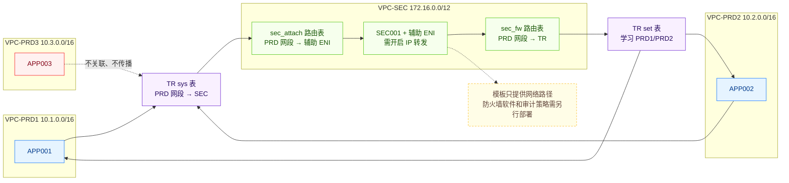

# 企业云上网络架构规划

规划并创建网络架构，以中转路由器为枢纽，将跨 VPC 东西向流量强制收敛至安全 VPC 统一检测审计，杜绝业务直连旁路、遏制威胁横向移动；独立业务默认隔离、按需互通，满足等保合规要求，并由 Terraform 一键交付、可审计可回收。

## 1. 业务背景

企业从 IDC 上云或优化现有网络架构时，通常需要同时处理以下问题：

- **受控互通与隔离并存**：部分业务区需要互访，部分业务区需要保持独立。
- **东西向流量缺少统一承载点**：跨业务区流量需要经过安全区，便于后续接入防火墙和审计策略。
- **直达路由可能绕过安全区**：业务 VPC 之间一旦存在直接转发路径，安全区就无法成为必经节点。
- **环境需要一致交付和回收**：网络、实例和路由关系需要通过声明式配置统一创建、变更和销毁。

本模板使用 Terraform 部署 VPC、子网、安全组、TR、ECS、辅助网卡和路由关系，为跨 VPC 安全互访提供网络基础。

## 2. 方案概述

模板采用“4 VPC + 1 TR + 1 台 SEC 转发实例”的结构：

- **VPC-PRD1 / VPC-PRD2**：分别承载 APP001 和 APP002。两个 VPC 关联 TR 的 `sys` 路由表，去往 PRD1/PRD2 的流量先被送入 VPC-SEC。
- **VPC-SEC**：承载 SEC001 及辅助 ENI。连接点子网路由把流量交给辅助 ENI，防火墙子网路由再把转发后的流量回注 TR。
- **TR `set` 路由表**：关联 SEC 连接，并学习 PRD1/PRD2 的子网路由，把从 SEC 返回的流量送到目的业务区。
- **VPC-PRD3**：创建 TR 连接，但不关联、不传播到自定义 TR 路由表，并关闭路由同步，因此当前配置不提供与其他 VPC 的互访路径。



以 APP001 访问 APP002 为例，数据路径为：

```text
APP001
  → PRD1 VPC 路由
  → TR sys 表
  → SEC 连接点子网路由
  → SEC001 辅助 ENI
  → SEC001 内核转发
  → SEC 防火墙子网路由
  → TR set 表
  → PRD2
  → APP002
```

重要边界：

- 模板创建 SEC001、辅助 ENI 和网络引流路径，但不安装商用防火墙或审计软件。
- SEC001 需要在操作系统内开启 IPv4 转发，否则 PRD1 与 PRD2 无法通过该节点互通。
- 当前只有一台 SEC001，且 4 台 ECS 均部署在 `zone1`；双可用区 TR 连接点不等于防火墙或业务实例高可用。
- 模板不创建 EIP、NAT 网关、VPN、堡垒机或公网负载均衡。
- 当前 `ssh_ingress_cidr` 默认值为 `0.0.0.0/0`，会为四个安全组创建面向任意 IPv4 来源的 TCP/22 入站规则。生产使用前必须改为受控管理网段。
- 四个安全组还共用 `10.0.0.0/8` 和 `172.16.0.0/12` 两条私网全协议入站规则；即使收窄 `ssh_ingress_cidr`，这些私网范围仍包含 TCP/22，应按实际业务协议进一步收窄。

## 3. IaC 设计

### 3.1 资源清单

按当前代码和示例参数，完整部署会创建 44 个 Terraform 管理对象，其中 38 个是云资源，6 个是仅用于销毁顺序的 `time_sleep` 等待对象。

| Terraform 资源 | 数量 | 用途 |
| --- | ---: | --- |
| `volcenginecc_vpc_vpc` | 4 | PRD1、PRD2、PRD3 和 SEC 四个 VPC |
| `volcenginecc_vpc_subnet` | 9 | PRD 各 2 个子网，SEC 包含连接点、防火墙和备可用区子网 |
| `volcenginecc_vpc_security_group` | 4 | 每个 VPC 一个安全组，并配置内联入站规则 |
| `volcenginecc_ecs_instance` | 4 | APP001、APP002、APP003 和 SEC001 |
| `volcenginecc_vpc_eni` | 1 | SEC001 辅助网卡，关闭源目地址校验 |
| `volcenginecc_vpc_route_table` | 2 | SEC 连接点引入路由和防火墙子网回注路由 |
| `volcenginecc_transitrouter_transit_router` | 1 | 连接四个 VPC 的中转路由器 |
| `volcenginecc_transitrouter_vpc_attachment` | 4 | 四个 VPC 分别接入 TR |
| `volcenginecc_transitrouter_transit_router_route_table` | 2 | `sys` 强制引流表和 `set` 回程表 |
| `volcenginecc_transitrouter_transit_router_route_table_association` | 3 | PRD1/PRD2 关联 `sys`，SEC 关联 `set` |
| `volcenginecc_transitrouter_route_table_propagation` | 2 | PRD1/PRD2 向 `set` 表传播路由 |
| `volcenginecc_transitrouter_transit_router_route_entry` | 2 | `sys` 表中指向 SEC 的 PRD1/PRD2 静态路由 |
| `time_sleep` | 6 | 在销毁阶段等待云端关联关系收敛，不创建云资源 |

模板没有 Data Source，也不引用调用方已有的 VPC、子网、TR 或 ECS。ECS 系统盘由实例资源内联创建并设置为随实例删除，不单独计入显式资源数量。

### 3.2 工程结构

```text
terraform-volcenginecc-enterprise-cloud-network-architecture/
├── README.md
├── main.tf
├── variables.tf
├── outputs.tf
├── providers.tf
├── versions.tf
├── terraform.tfvars
└── modules/
    ├── network/
    │   ├── vpc.tf
    │   ├── transit_router.tf
    │   ├── routing.tf
    │   ├── variables.tf
    │   ├── outputs.tf
    │   └── versions.tf
    └── compute/
        ├── main.tf
        ├── variables.tf
        ├── outputs.tf
        └── versions.tf
```

模块职责：

- 根模块接收用户输入，先调用 `network` 模块，再把子网、安全组、TR 和网段等输出传给 `compute` 模块。
- `network` 模块创建 VPC、子网、安全组、TR 连接和 TR 路由关系。
- `compute` 模块创建 ECS、辅助 ENI 和 SEC 内两张 VPC 路由表。
- 根模块和 `network` 模块中的 `time_sleep` 只约束销毁顺序，不参与业务数据转发。

子模块还定义以下内部输出，用于模块间传值；除非根模块再次声明，否则不会作为最终 `terraform output` 暴露：

| 子模块 | 内部输出 | 用途 |
| --- | --- | --- |
| `network` | `subnet_ids` | 把业务和 SEC 子网 ID 传给 `compute` |
| `network` | `security_group_ids` | 把四个安全组 ID 传给 `compute` |
| `network` | `sec_vpc_id` | 指定 SEC VPC 路由表所属 VPC |
| `network` | `sec_fw_subnet_id` | 指定 SEC001 和辅助 ENI 所在子网 |
| `network` | `sec_attach_subnet_id` | 指定 SEC 连接点路由表关联子网 |
| `network` | `sec_transit_router_attachment_id` | 暴露 SEC Attachment ID；当前根模块未继续使用或输出 |
| `network` | `prd_cidr_blocks` | 把 PRD1/PRD2 网段传给 SEC 路由表 |
| `compute` | `firewall_eni_id` | 暴露辅助 ENI ID；当前根模块未继续输出 |

### 3.3 核心代码示例

根模块通过模块输出把网络资源交给计算模块：

```hcl
module "network" {
  source = "./modules/network"

  common_name      = var.common_name
  region           = var.region
  zone1            = var.zone1
  zone2            = var.zone2
  ssh_ingress_cidr = var.ssh_ingress_cidr
  tags             = var.tags
}

module "compute" {
  source = "./modules/compute"

  subnet_ids           = module.network.subnet_ids
  security_group_ids   = module.network.security_group_ids
  sec_vpc_id           = module.network.sec_vpc_id
  sec_fw_subnet_id     = module.network.sec_fw_subnet_id
  sec_attach_subnet_id = module.network.sec_attach_subnet_id
  transit_router_id    = module.network.transit_router_id
  prd_cidr_blocks      = module.network.prd_cidr_blocks
}
```

TR 的 `sys` 路由表通过静态路由把业务网段流量送往 SEC 连接：

```hcl
resource "volcenginecc_transitrouter_transit_router_route_entry" "sys_to_sec_prd2" {
  transit_router_route_table_id            = volcenginecc_transitrouter_transit_router_route_table.sys.transit_router_route_table_id
  destination_cidr_block                   = volcenginecc_vpc_vpc.prd2.cidr_block
  transit_router_route_entry_next_hop_type = "Attachment"
  transit_router_route_entry_next_hop_id   = volcenginecc_transitrouter_vpc_attachment.sec.transit_router_attachment_id
  transit_router_route_entry_name          = "${var.common_name}-sys-prd2-to-sec"
}
```

## 4. 使用说明

本工程支持通过 InfraManager 在云上一键部署或下载模板在本地运行。推荐使用云上部署方式，无需自行准备 Terraform 运行环境，只需在平台填写参数即可完成资源创建和托管。

### 4.1 云上部署

InfraManager 是火山引擎提供的 Terraform 托管工作台，更多产品介绍参见 [InfraManager 产品介绍](https://docs.volcengine.com/docs/infrastructure-management/product-introduction?lang=zh)。

#### 4.1.1 准备权限

为 InfraManager 资源栈绑定专用 IAM 身份，并按最小权限原则授予以下能力：

- VPC、子网、安全组、安全组规则、VPC 路由表及路由条目的创建、查询、更新和删除。
- 中转路由器、VPC Attachment、TR 路由表、路由关联、路由传播和静态路由的创建、查询和删除。
- ECS 实例、系统盘和辅助 ENI 的创建、查询、更新和删除。
- 对上述支持标签的资源创建和更新标签。
- 查询地域、可用区、镜像、实例规格、库存和资源状态所需的只读权限。

`time_sleep` 是 Terraform 本地辅助资源，不需要额外云端权限。不要使用主账号长期凭证，部署身份的授权范围应限制在目标账号和地域。

#### 4.1.2 选择模板

打开 [InfraManager 控制台](https://console.volcengine.com/iac)，进入 **模板管理 > 公开模板**，搜索“企业云上网络架构规划”。

#### 4.1.3 创建资源栈

选择模板并点击 **创建资源栈**，填写地域、可用区、ECS 规格、镜像、实例密码、SSH 管理来源和标签。

创建执行计划后重点检查：

- 目标地域和两个可用区是否匹配，`zone1` 与 `zone2` 不能相同。
- `image_id` 是否在目标地域可用，`instance_type` 是否在 `zone1` 有库存。
- `instance_password` 是否已替换为本次部署的强密码。
- `ssh_ingress_cidr` 是否已从默认的 `0.0.0.0/0` 收窄为受控管理来源。
- 安全组中两条私网全协议规则是否符合业务要求；它们同样覆盖 TCP/22。
- 计划中是否只包含本模板预期管理的资源，没有意外替换或删除。

确认计划后执行部署。模板默认使用本地状态语义；在 InfraManager 中由平台托管资源栈状态。

#### 4.1.4 部署验证

资源栈状态为“成功”后，查看以下输出：

| 输出 | 用途 |
| --- | --- |
| `vpc_ids` | PRD1、PRD2、PRD3 和 SEC 的 VPC ID |
| `transit_router_id` | 中转路由器 ID |
| `app_instance_ids` | APP001、APP002、APP003 的实例 ID |
| `firewall_instance_id` | SEC001 实例 ID |
| `app_private_ips` | 三台业务实例的私网 IP |
| `firewall_private_ip` | SEC001 主网卡私网 IP |
| `firewall_eni_private_ip` | SEC001 辅助 ENI 私网 IP |

这些输出不包含密码，但资源 ID 和私网 IP 仍属于环境信息，应按内部资产信息管理。

按当前示例参数，资源栈包含 38 个云资源和 6 个本地等待对象。可以在 VPC、ECS 和中转路由器控制台核对资源名称是否使用 `common_name` 前缀。

### 4.2 本地部署

您也可以下载本工程模板在本地运行，需要按照下述步骤操作。

#### 4.2.1 环境准备

准备以下环境和前置条件：

1. Terraform `>= 1.5.7`。
2. `volcenginecc` Provider 约束为 `~> 0.0.70`。
3. `time` Provider 约束为 `~> 0.9`。
4. 目标账号已开通 VPC、ECS 和中转路由器服务，相关配额能够容纳资源清单中的对象。
5. `zone1` 中存在可用的 ECS 规格和镜像；`zone2` 与 `zone1` 属于同一地域且互不相同。
6. 已准备私网运维入口、堡垒机、VPN，或能够使用目标镜像中的云助手。模板本身不创建公网入口。

推荐通过环境变量注入访问凭证：

```bash
export VOLCENGINE_ACCESS_KEY="your_access_key"
export VOLCENGINE_SECRET_KEY="your_secret_key"
export VOLCENGINE_REGION="cn-beijing"
```

实例密码属于敏感输入，应在运行时覆盖，不要把真实密码写入 README、`terraform.tfvars` 或版本库：

```bash
export TF_VAR_instance_password='<replace-with-a-strong-password>'
```

根模块输入参数如下。默认值来自 `variables.tf`；“示例值”来自当前 `terraform.tfvars`。

| 参数 | 类型 | 默认值 / 示例值 | 说明 |
| --- | --- | --- | --- |
| `region` | `string` | 默认及示例：`cn-beijing` | 部署地域 |
| `zone1` | `string` | 默认及示例：`cn-beijing-a` | 主可用区，承载全部 ECS 和主子网 |
| `zone2` | `string` | 默认及示例：`cn-beijing-b` | 备可用区，必须与 `zone1` 不同 |
| `common_name` | `string` | 默认及示例：`enterprise-cloud` | 资源名称前缀 |
| `instance_type` | `string` | 默认及示例：`ecs.g3il.large` | 四台 ECS 使用的实例规格 |
| `image_id` | `string` | 当前默认及示例为一个北京地域镜像 ID | 镜像必须在目标地域可用 |
| `instance_password` | `string`，敏感 | 代码存在默认值；示例文件未赋值 | 长度 8～30，需满足四类字符中的至少三类；部署时应覆盖 |
| `ssh_ingress_cidr` | `string` | 默认：`0.0.0.0/0`；示例文件未赋值 | 为四个安全组创建 TCP/22 入站规则；部署前必须收窄 |
| `tags` | `map(string)` | 示例含 `project`、`environment`、`managed_by` | 必须包含 `environment`，且值不能为空；SEC 两张 VPC 路由表当前未使用该标签输入 |

使用本地状态时，State 可能包含密码和资源属性。请将 State 存放在受控位置，避免提交到版本库；团队协作建议配置受保护的远端 Backend。

#### 4.2.2 场景化部署示例

先覆盖敏感和高风险默认值：

```bash
export TF_VAR_instance_password='<replace-with-a-strong-password>'
export TF_VAR_ssh_ingress_cidr='192.0.2.10/32'
```

初始化并检查：

```bash
terraform init
terraform fmt -check -recursive
terraform validate
terraform plan
```

确认计划后部署：

```bash
terraform apply
```

注意：将 `ssh_ingress_cidr` 改为 `/32` 只会收窄显式 SSH 规则，不能消除 `10.0.0.0/8` 和 `172.16.0.0/12` 两条全协议规则对 TCP/22 的覆盖。生产环境应先在 `modules/network/vpc.tf` 中按实际业务协议和端口拆分规则。

参数变更行为：

| 变更 | 预期影响 |
| --- | --- |
| `ssh_ingress_cidr` | 更新四个安全组中的显式 TCP/22 规则 |
| `tags` | 更新支持且已配置标签的资源；SEC 两张 VPC 路由表当前不会继承 |
| `instance_password` | 更新 ECS 密码相关配置；执行前应检查 Plan 是否包含实例变更 |
| `instance_type`、`image_id`、`zone1` | 可能更新或替换 ECS，并影响子网归属；必须审核 Plan |
| `zone2` | 影响备可用区子网和 TR Attachment 连接点 |
| `region` | 影响 Provider 地域和可用区校验；跨地域部署应使用匹配的可用区和镜像 |

VPC 和子网 CIDR 当前硬编码在模块中，不是用户输入参数。需要修改网段时，应先完成地址冲突和路由影响评审。

#### 4.2.3 部署预期结果

部署完成后，预期创建：

- 4 个 VPC、9 个子网和 4 个安全组。
- 4 台 ECS、1 张辅助 ENI 和 2 张 SEC VPC 路由表。
- 1 个 TR、4 个 VPC Attachment、2 张 TR 自定义路由表。
- 3 个路由关联、2 个路由传播和 2 条 TR 静态路由。
- 6 个仅用于销毁顺序的 `time_sleep` 对象。

通过以下命令查看输出：

```bash
terraform output
```

| 输出 | 说明 |
| --- | --- |
| `vpc_ids` | 四个 VPC ID |
| `transit_router_id` | TR ID |
| `app_instance_ids` | 三台业务 ECS ID |
| `firewall_instance_id` | SEC001 ID |
| `app_private_ips` | APP001、APP002、APP003 私网 IP |
| `firewall_private_ip` | SEC001 主网卡私网 IP |
| `firewall_eni_private_ip` | SEC001 辅助 ENI 私网 IP |

模板不会创建 EIP、NAT 网关、VPN、堡垒机、防火墙软件或审计策略。仅完成 Terraform 部署并不代表业务互通已经成立，SEC001 还需要开启 IP 转发。

#### 4.2.4 部署后简易验证

以下验证会临时修改 SEC001 的运行时 `net.ipv4.ip_forward`。请在独占测试环境或维护窗口执行，IP 均从 `terraform output -json app_private_ips` 获取，结束后恢复原值。

1. **核对 TR 和 VPC 路由**
   - TR 应有 PRD1、PRD2、PRD3、SEC 四个 Attachment。
   - PRD1/PRD2 关联 `sys` 并开启路由同步；SEC 关联 `set`；PRD3 不关联自定义表。
   - `sys` 的 PRD1/PRD2 静态路由指向 SEC；`set` 学习 PRD1/PRD2 子网且没有 PRD3 路由。
   - `sec_attach` 子网路由指向辅助 ENI，`sec_fw` 子网路由指向 TR。

2. **检查实例并开启临时转发**
   ```bash
   hostname; ip -br addr; ip route; sysctl net.ipv4.ip_forward
   command -v ping; command -v tcpdump || true
   ```
   APP001/002/003 应位于各自子网；SEC001 应有主网卡和辅助 ENI。SEC001 的 `rp_filter` 不应为严格模式，FORWARD 链不应阻止转发。保存原值后开启转发：
   ```bash
   test ! -e /run/network-test-ip-forward.original
   sysctl -n net.ipv4.ip_forward > /run/network-test-ip-forward.original
   sysctl -w net.ipv4.ip_forward=1
   ```

3. **验证 PRD1 与 PRD2 双向互通并经过 SEC**
   在 SEC001 设置从输出取得的地址并启动抓包：
   ```bash
   APP001_IP="replace-with-app001-private-ip"
   APP002_IP="replace-with-app002-private-ip"
   timeout 45 tcpdump -nn -l -i any "icmp and host ${APP001_IP} and host ${APP002_IP}"
   ```
   同时在 APP001、APP002 分别执行 `ping -n -c 4 -W 2 <对端私网IP>`。预期双向成功，SEC抓包显示请求和应答从辅助 ENI 进入、从主网卡发出，源目IP保持不变。

4. **验证 PRD3 四方向隔离**
   APP001、APP002 分别探测 APP003，APP003 再分别探测 APP001、APP002。四个方向均应不可达；若任一方向可达，检查 PRD3 的TR关联、传播和路由同步。

5. **验证无旁路并恢复现场**
   在 SEC001 的独立终端运行子 Shell：
   ```bash
   ( prior=$(sysctl -n net.ipv4.ip_forward); trap 'sysctl -w net.ipv4.ip_forward="$prior" >/dev/null; echo RESTORED_TO_$prior' EXIT TERM INT; sysctl -w net.ipv4.ip_forward=0; echo CUT_READY; sleep 60 )
   ```
   `CUT_READY`后立即双向探测，预期通信中断；出现`RESTORED_TO_1`后应恢复。最后恢复测试前原值并清理：
   ```bash
   saved=$(cat /run/network-test-ip-forward.original)
   sysctl -w net.ipv4.ip_forward="$saved"
   rm -f /run/network-test-ip-forward.original
   sysctl -n net.ipv4.ip_forward
   ```
   最终值必须与初始值一致。本节不覆盖防火墙策略、审计规则、吞吐量或故障高可用。

#### 4.2.5 销毁资源

销毁前先查看删除计划：

```bash
terraform plan -destroy
```

确认已取得清理授权后执行：

```bash
terraform destroy
```

注意事项：

- 销毁会删除本模板管理的 VPC、子网、安全组、TR、路由、ECS、ENI 和系统盘。
- `time_sleep` 只在销毁阶段等待，不会增加普通 `terraform apply` 的等待时间。
- 销毁依赖大致为：先删除 compute 资源，等待 30 秒，再删除 TR 路由关系、路由表和各 Attachment，并在关键节点等待状态收敛。
- 固定等待不主动检查云端状态。若服务端关联状态尚未释放，应先确认实际资源状态，再重新执行销毁；不要手工删除不属于本模板的资源。
- 销毁完成后执行 `terraform state list`，并在 VPC、ECS 和 TR 控制台确认没有本次资源栈残留。

## 5. 总结

本模板适合用于搭建“业务 VPC 经安全区受控互访、独立业务区保持隔离”的网络基础：

- 使用 TR `sys`/`set` 双路由表和 SEC 内部 hairpin 路由建立强制引流路径。
- 使用未关联、未传播的 PRD3 Attachment 保留未来扩展入口，同时维持当前隔离。
- 使用 Terraform 模块输出连接网络与计算资源，并通过销毁等待降低异步状态未收敛带来的删除冲突。

交付或生产使用前，应进一步完成：

- 将 `ssh_ingress_cidr` 从默认 `0.0.0.0/0` 收窄为受控管理来源。
- 按业务端口拆分四个安全组，移除宽泛的私网全协议入站规则。
- 覆盖代码中的实例默认密码，并使用受控秘密管理和 State 存储。
- 为 SEC001 部署实际防火墙或审计软件，并由配置管理系统维护 IP 转发。
- 根据可用性目标部署多实例防火墙、健康检查和故障切换。
- 为两张 SEC VPC 路由表补充统一标签，并确认 `hashicorp/time` 是否符合交付环境的 Provider 策略。
- 根据运维需求补充 VPN、堡垒机、云助手或其他受控管理入口。
- 对当前提交重新执行验收，并用匹配版本的最终报告补充部署后简易验证。
